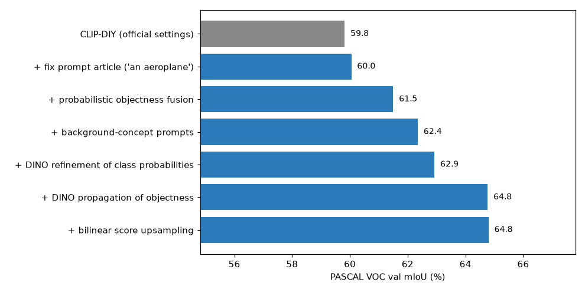
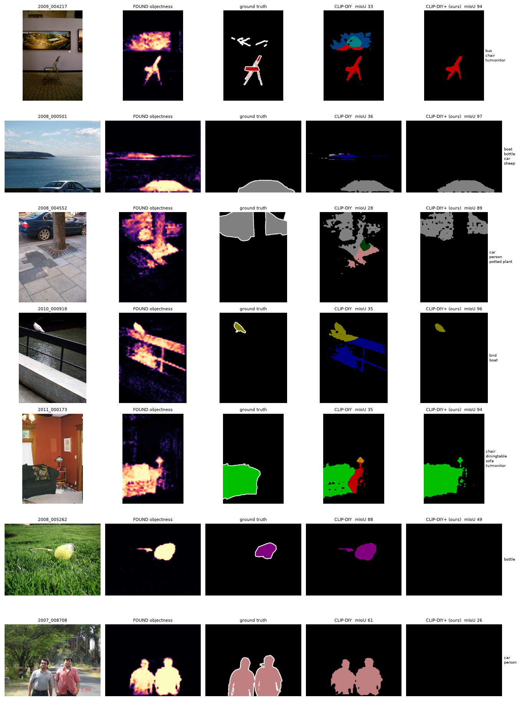
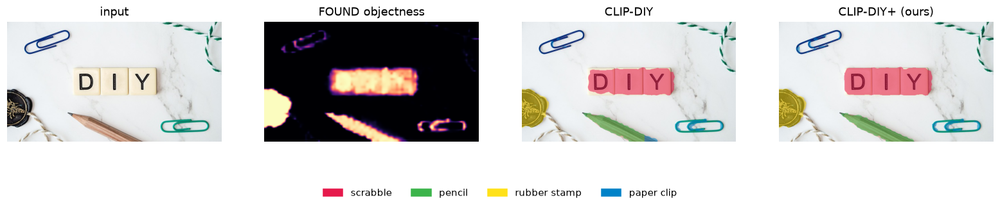

# CLIP-DIY+ — reproducing and improving CLIP-DIY (WACV 2024)

**Group Neuralink** — Pirathishanth A. (220480P), Dinuja M. (221019V) · EN4554 Deep Learning for Vision

Paper: Wysoczańska et al., *CLIP-DIY: CLIP Dense Inference Yields Open-Vocabulary Semantic Segmentation For-Free*,
WACV 2024 ([arXiv 2309.14289](https://arxiv.org/abs/2309.14289), [official code](https://github.com/wysoczanska/clip-diy)).

CLIP-DIY segments any set of text classes **without training**: CLIP classifies sliding windows at three
scales (256/128/64 px), the window scores are upsampled and averaged into dense maps, and an unsupervised
saliency model (FOUND) separates objects from background. This repo

1. **re-implements** the method as a small, tested package and **reproduces** the paper's numbers,
2. documents **bugs** in the official code,
3. adds **training-free improvements** (CLIP-DIY+), each behind a flag and measured in an ablation, with
   hyper-parameters chosen on a held-out *train* subset (never on val),
4. ships a CLI demo and a Gradio app for the live presentation.

No component is trained: CLIP (LAION-2B ViT-B/32), DINO ViT-S/8 and the FOUND decoder are used as released.
This keeps the paper's "for-free" property, and runs on a 4 GB laptop GPU (GTX 1650).

## Results

mIoU (%), CLIP ViT-B/32 (LAION-2B), same frozen models everywhere. CLIP-DIY+ hyper-parameters were chosen on
300 VOC **train** images and applied unchanged to VOC val and COCO-Object.

| Method | PASCAL VOC val (1449 img) | COCO-Object (1000-img random subset*) |
|---|---|---|
| CLIP-DIY, paper (Table 1) | 59.9 | 31.0 (full val) |
| CLIP-DIY, our reproduction | 59.8 | 32.3 |
| **CLIP-DIY+ (ours)** | **64.8 (+5.0)** | **35.3 (+3.0)** |

\* COCO: 1000 images sampled with seed 0 from the official evaluation set (≥1000 object px). Both methods use
the same images, so the gain is directly comparable; the absolute number differs slightly from the full set.

The paper's own ablations also reproduce: without objectness 24.4 (paper 24.1); single scale 256 px 56.3 (paper
56.0, "without multi-scale").



### Ablation on PASCAL VOC val (full tables: [VOC](results/ablations_voc_val_b32.md), [COCO](results/ablations_coco_val1000_b32.md))

| Step (cumulative) | VOC | Δ | COCO-Obj | Δ |
|---|---|---|---|---|
| CLIP-DIY (official settings) | 59.82 | – | 32.31 | – |
| + fix prompt article | 60.05 | +0.24 | 32.51 | +0.20 |
| + probabilistic objectness fusion | 61.50 | +1.68 | 33.08 | +0.77 |
| + background-concept prompts | 62.35 | +2.54 | 33.81 | +1.50 |
| + DINO refinement of class probabilities | 62.93 | +3.12 | 34.19 | +1.88 |
| + DINO propagation of objectness | 64.77 | +4.95 | 35.27 | +2.96 |
| + bilinear score upsampling = **CLIP-DIY+** | **64.80** | **+4.98** | **35.33** | **+3.02** |

| Leave one out from CLIP-DIY+ | VOC | COCO-Obj |
|---|---|---|
| CLIP-DIY+ (full) | 64.80 | 35.33 |
| w/o probabilistic fusion (also disables both DINO steps, which need it) | 60.10 | 32.55 |
| w/o background concepts | 64.26 | 34.78 |
| w/o DINO class refinement | 64.19 | 34.81 |
| w/o DINO objectness propagation | 62.95 | 34.22 |
| w/o FOUND objectness | 26.15 | 17.80 |

**Tried and rejected (negative results).** These were rejected because they did not help on the *train* subset
(see [tuning_log.txt](results/tuning_log.txt)). Added on top of CLIP-DIY+ on val: 80-template prompt ensemble
63.49 (−1.3), whole-image class filter 63.19 (−1.6), max-over-windows class filter 64.78 (±0), synonyms 64.91
(+0.1), flip TTA 64.97 (+0.2). We keep the train-subset decision rather than re-selecting on val.
Why the first two hurt: the templates were designed for whole images, while most of our crops are small 64-px
windows; the whole-image class filter removes true but small or secondary objects (VOC images often contain
person + another class).

**Where the gain comes from.** On the train subset ~60% of the remaining wrong pixels are object pixels that FOUND
marks as background, ~25% are background predicted as an object and only ~12% are wrong classes. That is why the
two objectness-related changes (probabilistic fusion with a lower background weight, and propagating
objectness to DINO-similar pixels) give most of the gain. On VOC every class improves (largest: bus +10.9,
person +8.6, sheep +7.7, sofa +7.5). On COCO a few classes drop (vase −6.1, baseball glove −4.1, potted plant
−3.2), which is consistent with background concepts such as "grass" or "tree" absorbing plant/garden objects.

### Qualitative (VOC val): five largest gains, then the two largest losses



Gains come mostly from removing hallucinated classes on salient background (painting → bus/tv, railing → boat,
tree trunk → person). The two failures show the new failure mode: when a 64-px window is dominated by grass or
trees, the background-concept prompt wins and a small or thin object is dropped.

### Demo image from the paper



### Speed (GTX 1650, 20 VOC images, 59 windows/img)

| | ms / image | agreement with official |
|---|---|---|
| official `ClipConv` (PIL crops + HF processor, fp32) | 517 | – |
| ours, GPU crops, fp32 | 407 (×1.3) | 98.1% identical argmax |
| ours, fp16 | 1912 | GTX 1650 has no tensor cores |

The full method costs ~1.5 s per image on this laptop GPU (CLIP for both views is cached even though flip is
off, FOUND/DINO on the full-resolution image); scoring CLIP-DIY+ from the cache takes 7 ms per image, so the
whole VOC val evaluation of one configuration takes ~10 s.

## What we changed and why

All functions below are in [segment.py](clipdiy/segment.py) unless noted. "Kept" = selected on the train subset.

| # | Change | Problem in CLIP-DIY it addresses | Kept? | Where |
|---|--------|----------------------------------|-------|-------|
| 1 | Correct prompt article ("a photo of **an** aeroplane") | `name.startswith('aeiou')` is never true, so every prompt uses "a" | yes | [prompts.py](clipdiy/prompts.py) |
| 2 | Probabilistic objectness fusion: P(bg)=λ(1−s)+s·P(bg-text\|fg), P(c)=s·P(c\|fg), softmax with CLIP's temperature (100) | official rule `argmax(cos·[1−s, s, …])` on raw cosines (all ≈0.2–0.3) is effectively a fixed saliency threshold ≈0.5, and CLIP's confidence barely matters | yes (λ=0.2) | `segment` |
| 3 | Background-concept prompts (sky, wall, floor, grass, …) mapped to label 0 | salient "stuff" regions are forced into an object class | yes | [prompts.py](clipdiy/prompts.py) |
| 4 | **DINO objectness propagation**: random walk of FOUND's saliency on a k-NN graph of DINO keys, added as a residual | FOUND misses object parts: ~60% of wrong pixels are object pixels marked background | yes (largest gain) | `refine_saliency` |
| 5 | DINO refinement of class probabilities (only salient nodes send evidence) | 64-px CLIP windows are blurry and leak across neighbouring objects | yes | `refine_probs` |
| 6 | Bilinear upsampling of scores instead of nearest on labels | blocky boundaries from 256² to evaluation resolution | yes | [evaluation.py](clipdiy/evaluation.py) |
| 7 | 80-template prompt ensemble | single template is a noisy text embedding | no (hurts) | [prompts.py](clipdiy/prompts.py) |
| 8 | Natural class names + synonyms (max over names) | `tv/monitor`, `diningtable` are poor CLIP queries | no (≈0) | `_per_class` |
| 9 | Horizontal-flip TTA | coarse 7×7 window grid | no (≈0) | `clip_maps` |
| 10 | Image-level class filtering (whole image or max over windows) | hallucinated absent classes | no (hurts) | `image_level_probs` |

The DINO keys used in 4 and 5 are computed by FOUND anyway, so both refinements are essentially free.

Engineering changes:
- **Cache once, ablate in seconds.** CLIP is a dual encoder, so window *image* embeddings, FOUND saliency and DINO
  keys are cached per image ([extract_features.py](scripts/extract_features.py)); every text/fusion experiment then
  costs ~10 ms per image. The whole ablation table runs in minutes instead of hours.
- **GPU crop pipeline** instead of crop→PIL→HF image processor; numerically equivalent to the official ClipConv
  (98% pixel agreement, differences come from PIL vs torch bicubic), see [benchmark_speed.py](scripts/benchmark_speed.py).
- **Single-GPU, no DDP/NCCL**, no Hydra; plain YAML configs and `key=value` overrides.
- **Unit tests** check that our original-mode fusion equals the official formula, that synonyms use max, flip
  consistency, the class filter, refinement and the metric ([tests/](tests/test_segment.py)).

## Bugs found in the official repository

| File | Issue | Effect |
|------|-------|--------|
| `src/clip_conv.py` `_create_prompt` | `text.startswith('aeiou')` instead of `text[0] in 'aeiou'` | "a photo of a aeroplane" |
| `src/clip_conv.py` `infer` + `eval_clipconv.py` | `logit_scale` loaded but unused; softmax applied after multiplying raw cosines by the saliency | the softmax does not change the argmax; the fusion behaves like a fixed saliency threshold |
| `configs/cfg_clip_pascal.yaml` | `output_dir: {paths.results}` (missing `$`) | results written to a literal `{paths.results}` folder |
| `eval_clipconv.py` | reads predictions from `cfg.results`, which is not defined | crashes after inference |
| `thirdparty/utils.py` `mkdir_if_missing` | uses `errno` without importing it | `NameError` on a race |
| `thirdparty/mscoco.py` `_preprocess` | checks `"full_coco"` but the config passes `"coco_full"` | COCO val keeps only images with ≥1000 object pixels (we match this to reproduce) |
| `src/clip_conv.py` `_group_patches` | assumes a square grid | only works because every image is squashed to 256×256 |

## Setup

```bash
uv venv .venv --python 3.12 && source .venv/bin/activate
uv pip install torch torchvision --index-url https://download.pytorch.org/whl/cu130   # match your driver
uv pip install -r requirements.txt
bash scripts/setup.sh            # clones FOUND, DINO and the official repo; downloads VOC 2012 (md5 checked)
bash scripts/setup.sh --coco     # optional: COCO val2017 for COCO-Object
```

## Reproduce everything

```bash
# 1. image-side features (GTX 1650: ~1.3 s/img; resumable)
python scripts/extract_features.py --dataset voc --split val   --out cache/voc_val_b32
python scripts/extract_features.py --dataset voc --split train --subset 300 --out cache/voc_train300_b32

# 2. choose CLIP-DIY+ hyper-parameters on 300 *train* images  -> configs/clipdiy_plus.yaml
python scripts/tune.py --cache cache/voc_train300_b32

# 3. evaluate on val
python scripts/evaluate.py --cache cache/voc_val_b32 --config configs/original.yaml      # CLIP-DIY
python scripts/evaluate.py --cache cache/voc_val_b32 --config configs/clipdiy_plus.yaml  # CLIP-DIY+
python scripts/run_ablations.py --cache cache/voc_val_b32                                # full table
python scripts/make_figures.py --cache cache/voc_val_b32                                 # figures

# COCO-Object (same tuned config, no re-tuning); drop --subset for the full set (~2 h on a GTX 1650)
python scripts/extract_features.py --dataset coco --root data/coco --split val --subset 1000 --out cache/coco_val1000_b32
python scripts/run_ablations.py --cache cache/coco_val1000_b32

# 4. demo
python scripts/demo.py third_party/clip-diy/images/diy-5090797_640.jpg scrabble pencil "rubber stamp" "paper clip"
python app.py                     # Gradio UI on http://127.0.0.1:7860
PYTEST_DISABLE_PLUGIN_AUTOLOAD=1 python -m pytest   # unit tests
```

## Code map

```
clipdiy/
  clip_dense.py   multi-scale sliding-window CLIP on GPU, text encoder
  found.py        FOUND saliency = DINO ViT-S/8 + 1x1 conv on last-layer keys (also returns the keys)
  features.py     per-image, vocabulary-independent features (cached)
  prompts.py      class names, synonyms, templates, background concepts
  segment.py      SegConfig, text bank, dense maps, fusion, class filter, DINO refinement
  evaluation.py   cache loading, prediction, dataset evaluation
  metrics.py      confusion-matrix mIoU
  data.py         PASCAL VOC / COCO-Object with the official evaluation protocol
  pipeline.py     single-image end-to-end pipeline (demo / app)
configs/          original.yaml (paper), clipdiy_plus.yaml (tuned on train subset)
scripts/          setup, extraction, tuning, evaluation, ablations, figures, speed benchmark, demo
tests/            unit tests
third_party/      official CLIP-DIY, FOUND, DINO (cloned by setup.sh, not modified)
```

## Limitations and honest notes

- Our improvements stay training-free; they cannot fix objects that FOUND misses entirely (e.g. thin paper clips in
  the demo image). The objectness map remains the main bottleneck (see the "w/o objectness" rows).
- Background-concept prompts can swallow small objects lying on grass or in front of trees (last two rows of the
  qualitative figure) and hurt a few COCO classes such as vase and potted plant.
- Hyper-parameters were tuned on 300 VOC *train* images and transferred unchanged to VOC val and COCO-Object.
  COCO numbers are on a 1000-image subset because of compute (laptop GPU); the full set is one command away.
- Only ViT-B/32 was evaluated; a ViT-B/16 backbone (finer windows) is the obvious next experiment.
- fp16 is off by default: on GPUs without tensor cores (GTX 1650) it was ~4× slower than fp32.
